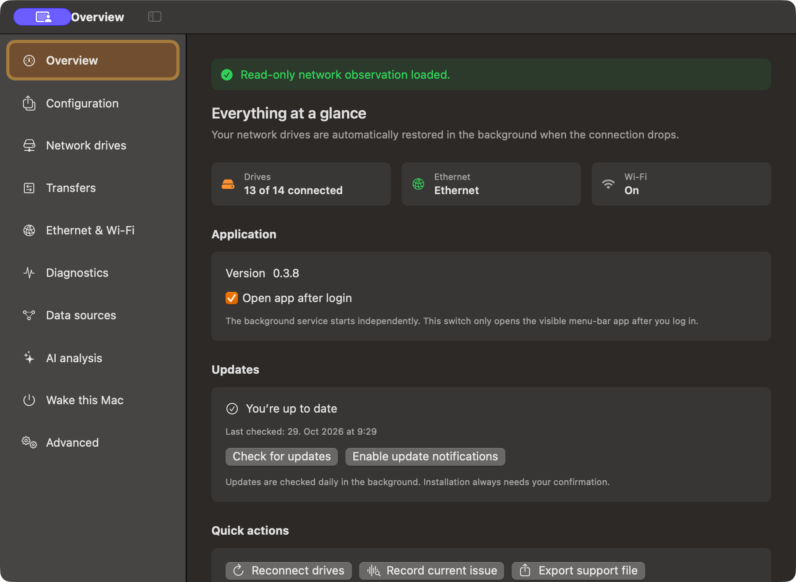
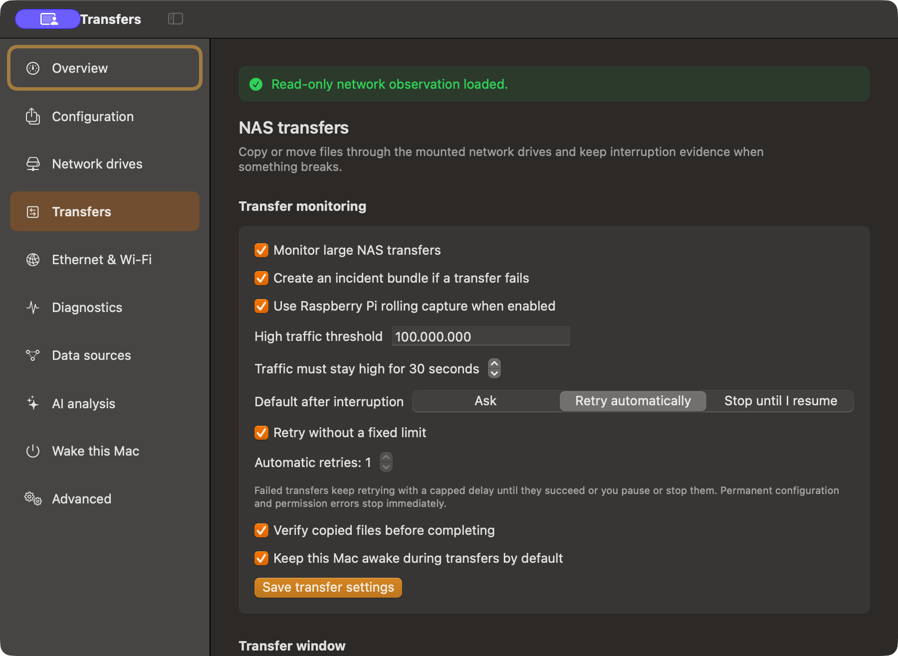

# We Rock Drive Mounts — SMB network drives for macOS

Keep your Synology NAS and other SMB network drives connected on your Mac. We Rock Drive Mounts is a native macOS menu bar app that monitors shared folders, reconnects drives after interruptions, and helps you copy files reliably between your Mac and NAS. It also gives you Ethernet and Wi-Fi controls, transfer history, and useful diagnostics when a connection fails.



## What you can do

- **Keep SMB shares available.** Add network drives that you normally open in Finder. The background service checks their health and reconnects missing drives with bounded retries. When a mounted drive stops responding, the app shows its recovery state and asks before any forced recovery.
- **Copy or move files between Mac and NAS.** Drop files on the menu bar app or start a transfer from Finder. Choose the destination, copy or move, what happens after an interruption, and whether to keep your Mac awake. Watch progress and transfer history in a separate window. File verification and controlled retries help with large transfers.
- **Prefer Ethernet while keeping Wi-Fi useful.** Let the app prefer a healthy wired connection, enable Wi-Fi if Ethernet fails, and open a temporary Wi-Fi window for AirDrop. See connected interfaces, traffic, and changes to monitored Ethernet port settings before choosing whether to restore preferred values.
- **Understand connection failures.** Record sleep and wake, network, SMB, and transfer events. Export a support ZIP with incident evidence. Optional Synology logs and a Raspberry Pi companion can add syslog and bounded packet captures. Local AI analysis is available on supported Macs; the app also provides rule-based diagnostics.
- **Wake your Mac remotely.** Configure and test the available Wake-on-LAN routes through a Raspberry Pi or other supported route, then enable only the routes you want to use.
- **Use the same settings from the app or terminal.** Export and import your `.wrdmconfig` configuration, inspect status with the `wrdm` command, or connect local automation through `wrdm-mcp`.



## Requirements

- macOS 15 Sequoia or later on Apple Silicon or Intel
- An SMB shared folder you can access from Finder, such as a Synology NAS share
- For local AI analysis: a supported Apple Silicon Mac running macOS 26 or later with Apple Intelligence enabled
- Optional: a Raspberry Pi with SSH access for packet capture, syslog, and Wake-on-LAN; Wireshark for live captures on the Mac

## Install on your Mac

1. Download the latest universal macOS `.pkg` from [GitHub Releases](https://github.com/wirrockendigital/We.Rock.Drive.Mounts/releases/latest).
2. Open the package and follow the macOS installer. The beta uses ad hoc signing, so macOS may ask for an additional confirmation when you first open it.
3. Open **We Rock Drive Mounts** from Applications. Its icon appears in the menu bar, and the background service starts monitoring your configured drives.

To build and install from source, use Xcode with the macOS 26 SDK and Swift 6.2 or later:

```bash
./install.sh
```

The installed app runs on macOS 15 or later. The source installer installs the app in `/Applications`, sets up its background service, and keeps your existing settings.

## Get started

1. Open the menu bar icon and choose **Settings**.
2. In **Network drives**, add the SMB shares you want the app to monitor, or import drives already mounted in Finder. Your passwords stay in macOS Keychain.
3. In **Ethernet & Wi-Fi**, choose whether to prefer Ethernet and when Wi-Fi should turn on or off. Use **Start AirDrop window** when you temporarily need Wi-Fi.
4. Drop files on the menu bar icon or choose **We Rock Transfer…** in Finder. Select a destination and a retry policy, then follow the job in **Transfers**.
5. If a drive or transfer fails, open **Overview** or **Diagnostics** to inspect its status. Use **Export support file** when you need to share a redacted support bundle.

A left click on the menu bar icon opens the transfer drop target; a right click opens status and actions. During transfers, the menu bar shows overall progress. The **Transfers** settings control defaults, while the separate transfer window shows current and past jobs.

### Recovery and transfer safety

The app distinguishes a missing share from an SMB mount that macOS still lists but that no longer responds. It checks that the old mount has detached before reconnecting it. Active We Rock Drive Mounts transfers protect their drive from unmounting. **Force recovery…** requires your confirmation; when macOS reports a mount that cannot be interrupted, the app shows **Restart required** and stops further recovery attempts for that boot.

For a move, source files are removed only after the copied data has been verified and the move is finalized. You can pause, stop, and resume transfer jobs. Automatic retries use a capped delay and stop on permanent configuration or permission errors.

### Configuration, updates, and command line

Use **Configuration** to export your setup as a `.wrdmconfig` file and import it for another local user on the same Mac. The file contains app settings, including share addresses and optional integration settings; passwords and tokens remain in macOS Keychain. Review the file before sharing it because addresses can identify your network.

Use **Check for updates** in **Overview** whenever you want to check the latest release. The app also checks daily in the background and shows available release notes before you choose to install an update. It waits for active transfers to finish.

The installer provides the `wrdm` command and local `wrdm-mcp` server. For example:

```bash
wrdm status
wrdm check
wrdm mounts list
wrdm transfer list
wrdm diagnostics export
```

See the [command-line reference](Documentation/CLI.md) for all commands. To uninstall the app while keeping your settings and diagnostics, run `./uninstall.sh` from the source checkout. To remove those user data as well, run `./uninstall.sh --purge`.

We Rock Drive Mounts is licensed under [GPL-3.0-or-later](LICENSE). The bundled Sparkle framework has its [own license](ThirdParty/Sparkle-LICENSE).
